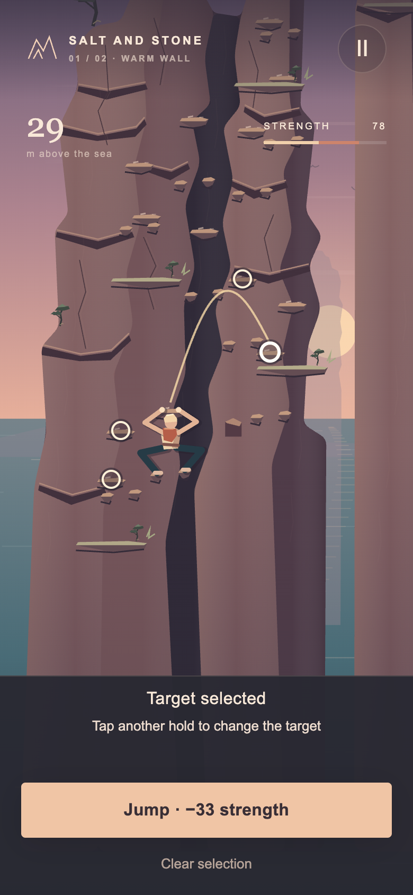
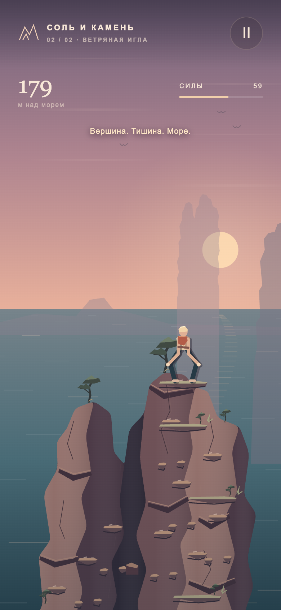

# Salt and Stone

**A small browser climbing game: two sandstone towers above the sea, one hand-built route to the top.** Tap a hold, see the trajectory, then commit to a reach, a jump or a step back, and spend your strength wisely. Made for phones in portrait mode.

**[▶ Play in the browser](https://tslava.github.io/salt-and-stone/)** · [Русская версия README](README.ru.md)

<p>
  
  
</p>

- **Hand-designed route**, no level generator: a cautious line (26 moves, 7 jumps) and a direct one (21 moves, 7 jumps), both verified without falls.
- **A body, not a sprite:** a rig with fixed bone lengths, hand and foot placement, whole-body collision checks against the rock.
- **Stamina, rest ledges and falls**, with the move cost shown before you commit.
- **No runtime dependencies:** plain ES modules and Canvas 2D, no external fonts, images or network requests.

**Stack:** JavaScript (ES modules) · Canvas 2D · Web Audio · Node test runner · Playwright browser tests

## Run locally

Node.js 22+:

```sh
npm run dev   # prints the address for this machine and for a phone on the same network
```

## Checks

```sh
npm ci
npm run check         # syntax and formatting
npm test              # 26 tests: mechanics, route, animation, tap controls
npm run test:browser  # full route in a real Chrome via Playwright
```

## Art

The rock is modelled on the sandstone of Saxon Switzerland (Schrammsteine). A photo by J.-H. Janßen ([CC BY-SA 4.0](https://commons.wikimedia.org/wiki/File:Saechsische_Schweiz_Schrammsteine_137.jpg)) was used as a study reference only; the game contains no photographic assets. Details in [docs/ART-DIRECTION.md](docs/ART-DIRECTION.md) (Russian).

## License

[MIT](LICENSE)

---

Built by [Wiaczeslaw Cyunczyk](https://tslava.dev)
